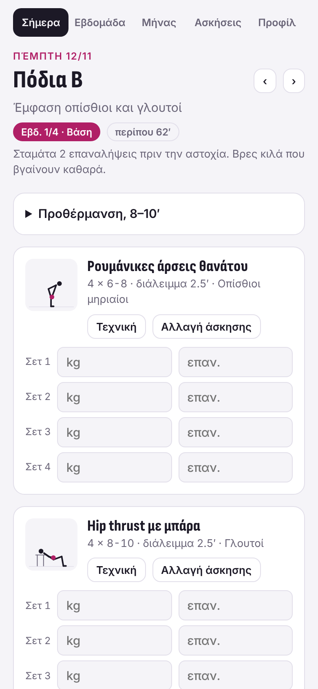
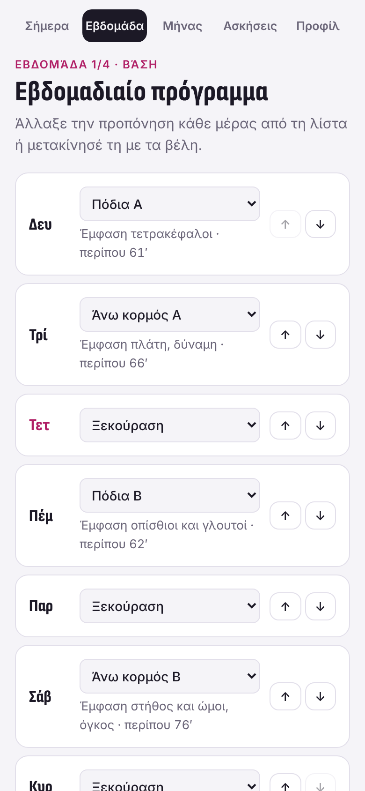
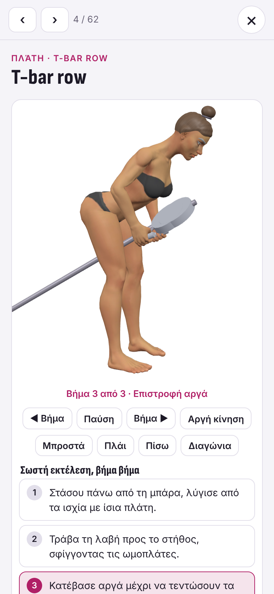
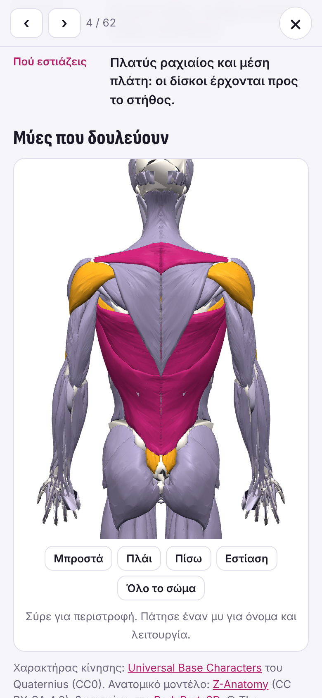
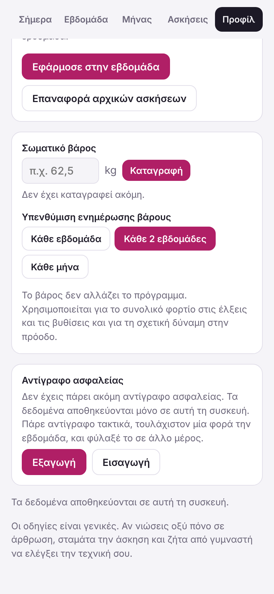
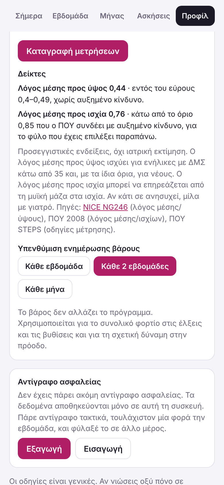

# Πλάνο Προπόνησης

Εφαρμογή γυμναστικής με πρόγραμμα προπόνησης, καταγραφή βαρών και επαναλήψεων, σωματικό βάρος και 3D οδηγό τεχνικής για κάθε άσκηση (κίνηση με ανθρώπινο χαρακτήρα και ανατομικό μοντέλο μυών).

**Εφαρμογή:** https://petrosfs.github.io/Gym-app-3D/

## Εικόνες

<table>
  <tr>
    <td align="center"> Προπόνηση της ημέρας</td>
    <td align="center"> Εβδομαδιαίο πρόγραμμα</td>
    <td align="center"> 3D κίνηση της άσκησης</td>
  </tr>
  <tr>
    <td align="center"> Μύες που δουλεύουν</td>
    <td align="center"> Αντίγραφο ασφαλείας</td>
    <td align="center"> Δείκτες υγείας (προαιρετικοί)</td>
  </tr>
</table>

## Εγκατάσταση στο κινητό (PWA)

- **Android (Chrome):** μενού ⋮ → «Εγκατάσταση εφαρμογής» ή «Προσθήκη στην αρχική οθόνη».
- **iPhone (Safari):** κουμπί Κοινοποίηση → «Προσθήκη στην αρχική οθόνη».

Μετά την πρώτη φόρτωση η εφαρμογή δουλεύει και χωρίς σύνδεση.

## Μέρες προπόνησης

Στο προφίλ διαλέγεις πώς ορίζονται οι μέρες:

- **Σταθερές μέρες:** ίδιο πρόγραμμα κάθε εβδομάδα.
- **Σταθερές μέρες με εξαιρέσεις:** δηλώνεις από πριν ημερομηνίες ή διαστήματα που δεν μπορείς· για καθεμία επιλέγεις μετάθεση στην επόμενη ελεύθερη μέρα ή παράλειψη.
- **Αλλάζουν κάθε εβδομάδα:** αλλαγές μόνο για τη συγκεκριμένη εβδομάδα, μετά επιστρέφει στο πρότυπο.
- **Χωρίς σταθερές μέρες:** κάθε εβδομάδα δηλώνεις τις μέρες που μπορείς και προτείνεται πρόγραμμα.

## Προφίλ και δείκτες

Στο προφίλ δηλώνεις φύλο, ηλικία (ομάδα ή ακριβής), ύψος και βάρος· υπολογίζεται ο ΔΜΣ. Πίσω από το «Περισσότερα» μπορείς προαιρετικά να καταγράψεις μετρήσεις (μέση, ισχία κ.λπ.) με οδηγίες σωστής μέτρησης· υπολογίζονται λόγος μέσης/ύψους και μέσης/ισχίων. Οι δείκτες είναι ενδεικτικοί και δεν αποτελούν ιατρική εκτίμηση. Πηγές: NICE NG246, ΠΟΥ 2008, ΠΟΥ STEPS.

## Πρόταση κιλών και επαναλήψεων

Σε κάθε άσκηση της ημέρας εμφανίζεται πρόταση:

- **Με ιστορικό:** διπλή πρόοδος. Αν την προηγούμενη φορά έπιασες το πάνω όριο επαναλήψεων σε όλα τα σετ, προτείνεται λίγο περισσότερο βάρος (2,5 kg σε μπάρα/τροχαλία, 1 kg σε αλτήρες) από το κάτω όριο. Αλλιώς ίδιο βάρος με μία επανάληψη παραπάνω. Μετά από διάλειμμα πάνω από 3 εβδομάδες, περίπου 10% λιγότερο. Στην αποφόρτιση και στη συντήρηση, ίδια κιλά.
- **Χωρίς ιστορικό:** για κάθισμα, πιέσεις πάγκου, άρση θανάτου, κωπηλατική με μπάρα, έλξεις τροχαλίας, κωπηλατική τροχαλίας, hip thrust, στρατιωτικές πιέσεις, πιέσεις ώμων με αλτήρες, πρέσα ποδιών, κωπηλατική με αλτήρα, πιέσεις πάγκου με αλτήρες, εκτάσεις και κάμψεις ποδιών στο μηχάνημα, ρουμάνικες άρσεις, κάμψεις με μπάρα, pushdown τρικεφάλων, πιέσεις με στενή λαβή, skull crusher και goblet squat, περίπου 50% του μέγιστου που αντιστοιχεί στο επίπεδο και το σωματικό βάρος (όρια Strength Level· όπου δεν υπάρχουν όρια για το φύλο σου, δεν δίνεται αριθμός), 10% λιγότερο από 65 και πάνω. Για τις υπόλοιπες, οδηγία να ξεκινήσεις ελαφριά.

## Αποθεραπεία

Στο τέλος κάθε προπόνησης υπάρχει προαιρετική αποθεραπεία: χαλαρή αερόβια και στατικές διατάσεις για τους μύες που δούλεψαν. Από ηλικία 50 και πάνω προτείνεται και ανοίγει αυτόματα, με μεγαλύτερο χαλαρό περπάτημα· από 65 και πάνω κάθε διάταση κρατιέται 30–60″ (ACSM). Η διάρκεια είναι περίπου 13′ (15′ από 50, 18′ από 65) και δεν μετρά στον χρόνο της προπόνησης. Εμφανίζεται ή κρύβεται από το Προφίλ.

## Δεδομένα και αντίγραφο ασφαλείας

Όλα τα δεδομένα (προφίλ, πρόγραμμα, καταγραφές, σωματικό βάρος) αποθηκεύονται μόνο στη συσκευή και τον browser που χρησιμοποιείς. Αν καθαρίσεις τα δεδομένα του browser ή αλλάξεις συσκευή, χάνονται.

Στην ενότητα **Προφίλ** υπάρχουν τα κουμπιά **Εξαγωγή** και **Εισαγωγή** για αντίγραφο ασφαλείας. Η εφαρμογή σου θυμίζει να πάρεις αντίγραφο όταν έχουν περάσει 7 μέρες από το τελευταίο.

## Αρχεία

- `index.html`: η εφαρμογή
- `char_f.json`, `char_m.json`: οι 3D χαρακτήρες
- `muscles.json`: το ανατομικό μοντέλο μυών
- `screenshots/`: οι εικόνες αυτού του README

Η εφαρμογή είναι στατική σελίδα και δεν χρειάζεται build. Για τοπική εκτέλεση σέρβιρε τον φάκελο με οποιονδήποτε στατικό server, π.χ. `python3 -m http.server`.

## Πηγές και άδειες

- Χαρακτήρες κίνησης: [Universal Base Characters](https://quaternius.com/packs/universalbasecharacters.html) του Quaternius (CC0).
- Ανατομικό μοντέλο: [Z-Anatomy](https://github.com/Z-Anatomy/The-blend) (CC BY-SA 4.0), βασισμένο στο [BodyParts3D](https://dbarchive.biosciencedbc.jp/en/bodyparts3d/), © The Database Center for Life Science (CC BY 4.0). Το `muscles.json` είναι απλοποιημένη εκδοχή του και ισχύει για αυτό η άδεια CC BY-SA 4.0.
